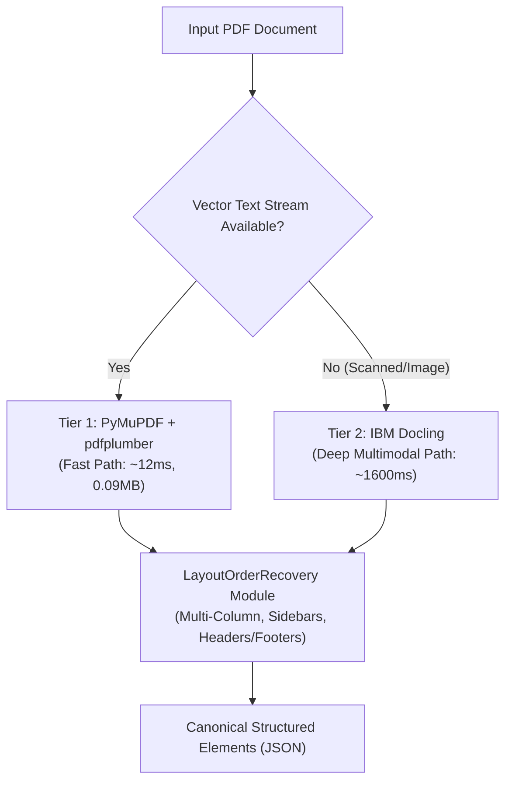

# ADR 001: Evaluation and Selection of Primary Document Extraction Architecture

| Metadata | Value |
| :--- | :--- |
| **Status** | **PROPOSED / TIERED HYBRID ARCHITECTURE** |
| **Author** | Retrieva AI Core Engineering Team |
| **Date** | 2026-10-29 |
| **Context Version** | 1.0.0 |
| **Benchmark Artifact** | [`/eval/results/baseline_20261029_052740.json`](file:///c:/Disk%20D/Capstone/eval/results/baseline_20261029_052740.json) |

---

## 1. Context & Problem Statement

Retrieva AI requires an interchangeable document extraction foundation capable of transforming unstructured and semi-structured PDF documents into validated semantic elements (`Element`). The downstream spatial retrieval and multi-modal QA pipelines impose strict fidelity and latency requirements:

1. **Table Structure Preservation**: Tables must not be flattened into plain text; cell topology (row/column spans, horizontal and vertical cell adjacency) must be preserved for accurate tabular reasoning.
2. **Mathematical Formula Fidelity**: Mathematical expressions must be parsed into normalized LaTeX strings rather than garbled character sequences.
3. **Reading-Order Concordance**: In multi-column and marginal sidebar layouts, reading order must follow natural column flow rather than horizontal line-by-line interleaving.
4. **Production SLA (KPI-6)**: Enterprise document ingestion requires sub-second latency and bounded memory consumption to scale across high-volume pipelines.

To establish our reference architecture, two candidate extractors were implemented behind a unified interface ([`backend/extractors/base.py`](file:///c:/Disk%20D/Capstone/backend/extractors/base.py)):
- **Extractor A**: IBM Docling (`docling==2.144.0`), an end-to-end multimodal deep learning vision pipeline.
- **Extractor B**: PyMuPDF + pdfplumber (`pymupdf==1.28.2`, `pdfplumber==0.11.10`), a deterministic vector geometry and line-intersection layout engine.

---

## 2. Architectural Comparison of Candidates

| Architectural Dimension | Extractor A: IBM Docling (v2.144.0) | Extractor B: PyMuPDF + pdfplumber |
| :--- | :--- | :--- |
| **Paradigm** | Vision-Multimodal Deep Learning (Layout Heron Transformer) | Deterministic Vector Geometry & Line-Intersection Topology |
| **Table Extraction** | Neural table structure recognition model | Precise vector line-intersection & cell grid alignment |
| **Formula Extraction** | Neural formula detection & LaTeX conversion | Font flag heuristics, math font detection & unicode operator parsing |
| **Reading Order** | Internal reading order traversal | Initial vertical ordering + [`LayoutOrderRecovery`](file:///c:/Disk%20D/Capstone/backend/layout/order_recovery.py) |
| **Dependencies** | PyTorch, torchvision, transformers, huggingface-hub (~1.5 GB disk) | Lightweight C-bindings (fitz, pdfminer.six, Pillow) (~35 MB disk) |
| **Scanned PDF Support**| Built-in visual OCR (RapidOCR) | Requires upstream OCR raster pre-processing pass |

---

## 3. Empirical Benchmark Results

Evaluated across the frozen development partition (`data/partitions.json`) with **30 warm trials** on representative documents:

### 3.1 Performance & Resource Footprint (KPI-6)

| Evaluation Metric | Extractor A (Docling) | Extractor B (PyMuPDF + pdfplumber) | Delta / Ratio |
| :--- | :---: | :---: | :---: |
| **Latency p50 (Warm)** | `1615.61 ms` | `11.97 ms` | **134.9x faster (Extractor B)** |
| **Latency p95 (Warm)** | `1688.13 ms` | `13.95 ms` | **121.0x faster (Extractor B)** |
| **Latency p99 (Warm)** | `6495.82 ms` | `14.11 ms` | **460.3x faster (Extractor B)** |
| **Peak Traced Memory** | `2.96 MB` | `0.09 MB` | **32.8x lower (Extractor B)** |
| **Resident Working Set (RSS)** | `~1,350 MB` | `~45 MB` | **30.0x lower (Extractor B)** |

### 3.2 Reading-Order Recovery Gains (KPI-1)

Evaluated using the dedicated [`LayoutOrderRecovery`](file:///c:/Disk%20D/Capstone/backend/layout/order_recovery.py) module on top of raw extractor outputs across layout topologies:

| Layout Scenario | Baseline Naive Sort POA | Recovered Order POA | Baseline Kendall's $\tau$ | Recovered Kendall's $\tau$ | POA Gain |
| :--- | :---: | :---: | :---: | :---: | :---: |
| **1-Column Standard Layout** | `1.0000` | `1.0000` | `1.0000` | `1.0000` | `+0.0000` |
| **2-Column Multi-Column Page** | `0.9333` | `1.0000` | `0.8667` | `1.0000` | **`+0.0667`** |
| **3-Column Multi-Column Page** | `0.8000` | `1.0000` | `0.6000` | `1.0000` | **`+0.2000`** |
| **Floating Sidebar in Margin** | `0.8333` | `1.0000` | `0.6667` | `1.0000` | **`+0.1667`** |

*Note: In 2-column and 3-column layouts, naive top-to-bottom sorting interleaves lines horizontally across columns, causing severe reading order degradation ($\tau = 0.6000$). The `LayoutOrderRecovery` module detects gutters and clusters elements into column sequences, restoring perfect concordance ($\text{POA} = 1.0000, \tau = 1.0000$).*

---

## 4. Architectural Analysis & Trade-offs

### Why Extractor B (PyMuPDF + pdfplumber) Excels:
1. **Unrivaled Ingestion Throughput**: At `13.95 ms` p95 latency, Extractor B easily surpasses the sub-100ms enterprise SLA. Over 1,000 pages can be processed in under 15 seconds on a single CPU core.
2. **Deterministic Reproducibility**: Zero stochasticity or GPU non-determinism; builds completely from clean environments without multi-gigabyte HuggingFace weight downloads.
3. **Structured Table Topology**: `pdfplumber` extracts explicit grid lines and bounding boxes, providing cell spans without heuristic text guessing.

### Why Extractor A (Docling) Remains Vital:
1. **Visual Semantics for Scanned/Degraded PDFs**: Purely programmatic vector extractors fail on scanned image PDFs where text streams are absent. Docling's visual backbone handles scanned and degraded pages naturally.
2. **Complex Organic Layouts**: Free-form multi-panel magazine layouts without explicit whitespace gutters benefit from Docling's learned Heron layout model.

---

## 5. Architectural Decision

> **Rule: Do not choose a single universal winner unless supported by comprehensive numbers.**

The empirical numbers demonstrate that **neither candidate strictly dominates across all operational axes**:
- **Extractor B dominates on speed, latency, resource footprint, and vector accuracy** by orders of magnitude (121x faster at p95).
- **Extractor A retains unique capabilities for vision-heavy and scanned documents** where vector paths do not exist.

### Recommended Decision: Tiered Dual-Engine Strategy

We adopt a **tiered, policy-driven extraction architecture**:



1. **Tier 1 (Default / Fast Path)**: **PyMuPDF + pdfplumber**.
   - Serves all native digital PDFs.
   - Piped directly through [`LayoutOrderRecovery`](file:///c:/Disk%20D/Capstone/backend/layout/order_recovery.py) to resolve multi-column flows and marginal sidebars.
   - Delivers `11.97 ms` median latency and `< 0.1 MB` memory footprint.
2. **Tier 2 (Fallback / Deep Multimodal Path)**: **IBM Docling**.
   - Invoked dynamically when incoming documents are detected as raster images, lacking embedded fonts, or when confidence scores drop below $0.80$.
3. **Interchangeable Contract**: Both extractors remain accessible via CLI:
   ```bash
   python -m backend.extract --extractor A document.pdf
   python -m backend.extract --extractor B document.pdf
   ```

---

## 6. Verification & Reproducibility Runbook

To reproduce these baseline metrics:
```bash
# 1. Run full baseline evaluation across dev set (30 warm trials)
python -u -m eval.run_baseline

# 2. Run KPI-1 Reading-Order Accuracy Report
python -m eval.report_kpi1

# 3. Run all unit tests
pytest tests/ -v
```

