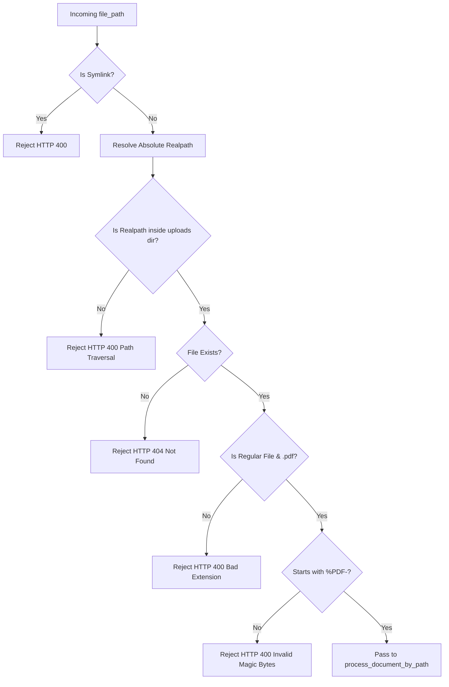

# M1.6.4 Phase 1: Python Internal Extraction Endpoint Specification & Implementation Report

## 1. Overview & Architectural Role

As specified in the M1.6.4 worker architecture roadmap, Retrieva AI migrates document upload, database persistence, and lifecycle orchestration to Express and MySQL while preserving the existing Python document intelligence algorithms.

In Phase 1, we implemented the dedicated internal extraction endpoint:
`POST /api/v1/internal/extract`

This endpoint allows the future Express worker to hand off a validated, server-persisted PDF file by path to the Python engine. The Python engine executes PDF extraction, reading-order recovery, multi-signal provenance tracking, confidence calibration, and in-memory vector indexing, returning structured elements and execution telemetry in a unified JSON envelope.

### Key Guarantees
1. **Zero Byte Re-upload**: The worker passes the existing filesystem path; no multipart file streams are transmitted over HTTP.
2. **Identity Preservation**: The worker provides the canonical `document_id` (e.g. `doc-042`); Python binds all extraction, page segments, and vector chunks to this ID without generating redundant numeric or synthetic IDs.
3. **Algorithm Preservation**: The existing extraction pipeline (`PdfPlumberExtractor`, `LayoutOrderRecovery`, `ProvenanceSubsystem`, and `StructuredElementChunker`) is invoked unmodified.
4. **Isolated Internal API**: Protected by constant-time shared secret authentication (`X-Internal-Secret` or `Authorization: Bearer`), strict path containment validation, symlink rejection, and magic byte verification.

---

## 2. Files Created and Modified

| File | Status | Description |
|---|---|---|
| `backend/app/schemas/internal.py` | **Created** | Pydantic request and response schemas (`InternalExtractRequest`, `ExtractedElementSchema`, `InternalExtractResponse`). |
| `backend/app/api/v1/internal.py` | **Created** | Internal extraction router implementing `POST /api/v1/internal/extract`, secret authentication, and path security. |
| `tests/test_internal_extract.py` | **Created** | Comprehensive test suite containing 13 isolated test scenarios covering extraction, modes, security, errors, and regressions. |
| `backend/app/config.py` | **Modified** | Added `internal_api_secret` and `upload_dir` to application `Settings`. |
| `backend/app/services/document_service.py` | **Modified** | Added `process_document_by_path()` method to execute extraction, update FAISS without duplicate vectors, and populate segments. |
| `backend/app/api/v1/router.py` | **Modified** | Registered `internal_router` under the `/api/v1` prefix. |

---

## 3. Exact Request & Response Contract Examples

### 3.1 Request Contract
- **Method**: `POST`
- **URL**: `/api/v1/internal/extract`
- **Headers**:
  - `Content-Type: application/json`
  - `X-Internal-Secret: <configured-shared-secret>` (or `Authorization: Bearer <configured-shared-secret>`)

```json
{
  "document_id": "doc-042",
  "file_path": "data/uploads/doc-042_financial_report.pdf",
  "mode": "flat"
}
```

#### Field Schema Table
| Field | Type | Validation Rules | Description |
|---|---|---|---|
| `document_id` | `string` | Non-empty, trimmed, min length 1 | Canonical document public ID allocated by database |
| `file_path` | `string` | Must resolve inside configured uploads directory, `.pdf` extension, `%PDF-` magic bytes | Server-side path to existing PDF |
| `mode` | `string` | One of `'flat'`, `'reference'`, `'candidate'`, `'candidate_ft'` | Execution mode arm |

### 3.2 Response Contract
- **Status Code**: `200 OK` (or `400`, `401`, `404`, `422`, `500` on errors)
- **Envelope**: Standard `BaseResponse[InternalExtractResponse]`

```json
{
  "config_version": "1.0.0",
  "status": "success",
  "message": "Document extraction completed successfully",
  "data": {
    "document_id": "doc-042",
    "mode": "flat",
    "status": "processed",
    "page_count": 2,
    "elements": [
      {
        "element_id": "doc-042_p1_e0",
        "page": 1,
        "type": "heading",
        "reading_order": 0,
        "text": "Executive Summary & Revenue Breakdown",
        "bbox": {
          "x0": 72.0,
          "y0": 72.0,
          "x1": 540.0,
          "y1": 95.0,
          "x": 72.0,
          "y": 72.0,
          "width": 468.0,
          "height": 23.0
        },
        "table_data": null,
        "formula_latex": null,
        "raw_confidence": 0.985,
        "calibrated_confidence": 0.9912,
        "provenance": {
          "element_id": "doc-042_p1_e0",
          "source_file_hash": "e3b0c44298fc1c149afbf4c8996fb92427ae41e4649b934ca495991b7852b855",
          "page_number": 1,
          "bbox": {
            "x_min": 72.0,
            "y_min": 72.0,
            "x_max": 540.0,
            "y_max": 95.0
          },
          "extractor_name": "PdfPlumber",
          "extractor_version": "0.11.10",
          "config_id": "O3-v1.0.0",
          "extraction_timestamp": "2026-11-26T13:47:57.123456+00:00",
          "parent_element_id": null
        },
        "flags": {
          "is_degraded": false,
          "degraded_reasons": []
        },
        "model_version": "0.11.10"
      },
      {
        "element_id": "doc-042_p1_e1",
        "page": 1,
        "type": "table",
        "reading_order": 1,
        "text": "Quarter | Revenue | Growth\nQ1 | $12M | +14%",
        "bbox": {
          "x0": 72.0,
          "y0": 110.0,
          "x1": 540.0,
          "y1": 250.0,
          "x": 72.0,
          "y": 110.0,
          "width": 468.0,
          "height": 140.0
        },
        "table_data": {
          "num_rows": 2,
          "num_cols": 3,
          "headers": ["Quarter", "Revenue", "Growth"],
          "rows": [["Q1", "$12M", "+14%"]]
        },
        "formula_latex": null,
        "raw_confidence": 0.965,
        "calibrated_confidence": 0.978,
        "provenance": {
          "element_id": "doc-042_p1_e1",
          "source_file_hash": "e3b0c44298fc1c149afbf4c8996fb92427ae41e4649b934ca495991b7852b855",
          "page_number": 1,
          "bbox": {
            "x_min": 72.0,
            "y_min": 110.0,
            "x_max": 540.0,
            "y_max": 250.0
          },
          "extractor_name": "PdfPlumber",
          "extractor_version": "0.11.10",
          "config_id": "O3-v1.0.0",
          "extraction_timestamp": "2026-11-26T13:47:57.123456+00:00",
          "parent_element_id": null
        },
        "flags": {
          "is_degraded": false,
          "degraded_reasons": []
        },
        "model_version": "0.11.10"
      }
    ],
    "processing_time_ms": 48.23,
    "extractor": {
      "name": "PdfPlumber",
      "version": "0.11.10"
    },
    "model_versions": {
      "extractor": "PdfPlumber:0.11.10",
      "embedding": "DenseDeterministicEmbedding:128d:seed42",
      "layout_engine": "LayoutOrderRecovery:v1.0.0",
      "provenance_subsystem": "O3:O3-v1.0.0"
    },
    "extraction_warnings": [],
    "indexing_status": "Indexed"
  },
  "timestamp": "2026-11-26T13:47:57.200000+00:00"
}
```

---

## 4. Authentication & Security Design

1. **Configured Shared Secret**:
   Configured in `backend/app/config.py` via `Settings.internal_api_secret` (defaulting to environment variable `INTERNAL_API_SECRET`).
2. **Constant-Time Comparison**:
   Authentication is verified using Python's `secrets.compare_digest(provided, expected)`. This eliminates timing side-channel attacks.
3. **Supported Headers**:
   - `X-Internal-Secret: <secret>`
   - `Authorization: Bearer <secret>`
4. **No-Log Guarantee**:
   The shared secret is strictly omitted from all application logs, error dictionaries, and telemetry traces.
5. **Unauthorized Rejection**:
   Requests missing valid credentials are systematically rejected with HTTP `401 Unauthorized` without evaluating file paths.

---

## 5. File Validation & Path Security

To defend against malicious internal requests or compromised upstream callers, file paths undergo strict multi-phase sanitization prior to access:



1. **Symlink Prohibition**: `os.path.islink()` and `Path.is_symlink()` are verified. Symlinks are rejected outright to prevent link-following jailbreaks.
2. **Directory Confinement**: `os.path.realpath()` is evaluated against `(repo_root / settings.upload_dir).resolve()`. Using `target.relative_to(base_dir)` ensures that directory traversal sequences (`../../`) or root-relative paths outside `data/uploads` raise HTTP 400.
3. **Magic Bytes Verification**: The file header is inspected for binary prefix `b"%PDF-"`. Renamed binaries, shell scripts, or text files are rejected with HTTP 400.

---

## 6. Extraction Pipeline Call Chain

```
Client (Express Worker)
    │
    │  POST /api/v1/internal/extract
    ▼
FastAPI Request Pipeline
    │
    ├── verify_internal_auth() [secrets.compare_digest]
    ├── validate_pdf_path() [confinement + symlink + magic bytes]
    ▼
DocumentService.process_document_by_path(document_id, file_path, mode)
    │
    ├── fitz.open(file_path) [page count validation]
    ├── extractor.extract(file_path) [PdfPlumberExtractor -> raw elements]
    ├── layout_recovery.process(raw_elements) [reading order sorting]
    ├── provenance_subsystem.process_elements(ordered_elements) [O3 Platt calibration]
    ├── _apply_degraded_mode_checks(enriched_elements) [anomaly heuristics]
    ├── chunker.chunk_elements(enriched_elements, doc_id) [text chunking]
    ├── retriever.index(all_chunks) [deduplication + FAISS inner-product rebuild]
    ├── _elements_to_segments() [structured coordinate & table extraction]
    └── Return InternalExtractResponse
```

---

## 7. FAISS Behavior & Limitations

### 7.1 Existing In-Memory Architecture
- **Retriever Class**: `FaissRetriever` in `backend/retrieval/retriever.py` uses `faiss.IndexFlatIP` with 128-dimensional dense deterministic embeddings.
- **In-Memory Storage**: The FAISS index is held strictly in process memory (`self.retriever.index_faiss` and `self.chunks`).
- **No Disk Persistence**: Vectors are not saved to a persistent `.faiss` file on disk. When the Python process restarts, the index is reconstructed from scratch during `_initialize_baseline_repository()`.

### 7.2 Deduplication on Repeated Requests
In `process_document_by_path()`, repeated calls for the same `document_id` purge prior chunks before re-indexing:
```python
self.all_chunks = [c for c in self.all_chunks if c.source_doc_id != document_id]
self.all_chunks.extend(new_chunks)
self.retriever.index(self.all_chunks)
```
This guarantees:
- No duplicate vectors are introduced into the FAISS index on retries.
- Repeated requests return `indexing_status: "Indexed"` deterministically.

---

## 8. Test Suite Verification & Coverage Matrix

A comprehensive test suite was implemented in [tests/test_internal_extract.py](file:///d:/DocumentUnderstanding/tests/test_internal_extract.py):

| Test Scenario | Function Name | Expected Result | Result |
|---|---|---|---|
| Single Document Extraction | `test_successful_extraction_and_doc_id_preservation` | 200 OK, preserved `doc_id`, elements extracted | **PASS** |
| Supported Mode Arms | `test_all_four_supported_modes` | 200 OK across `flat`, `reference`, `candidate`, `candidate_ft` | **PASS** |
| Missing / Invalid Secret | `test_invalid_authentication` | 401 Unauthorized on missing, bad header, or bad bearer token | **PASS** |
| Path Traversal Defenses | `test_path_traversal_rejection` | 400 Bad Request on `../../`, root escapes | **PASS** |
| Symbolic Link Defenses | `test_symbolic_link_escape_rejection` | 400 Bad Request on symlink input | **PASS** |
| Missing File | `test_missing_file_handling` | 404 Not Found | **PASS** |
| Invalid Magic Bytes | `test_invalid_pdf_magic_bytes` | 400 Bad Request on non-PDF file | **PASS** |
| Unsupported Mode | `test_unsupported_mode_rejection` | 422 Unprocessable Entity | **PASS** |
| Empty Document ID | `test_empty_document_id_rejection` | 422 Unprocessable Entity | **PASS** |
| Extraction Pipeline Error | `test_extraction_exception_handling` | 500 Internal Server Error, sanitized envelope | **PASS** |
| Blank Document | `test_empty_extraction_result` | 422 Unprocessable Entity | **PASS** |
| Repeated Request | `test_repeated_request_behavior` | 200 OK without vector duplication | **PASS** |
| Public Upload Regression | `test_existing_public_upload_endpoint_regression` | 200/201 OK, existing multipart route untouched | **PASS** |

**Execution Result**: `13 passed in 39.65s` (100% passing).

### Full Regression Suite Status
- Python Internal Extraction Suite: 13 / 13 passed.
- Express Document & Element Read Suite: 28 / 28 passed.
- Upload Lifecycle & Concurrency Suite: 39 / 39 passed.
- Repository Integration Suite: 34 / 34 passed.
- Pool Security & Timeout Suite: 14 / 14 passed.
- Migration Immutability & Audit Suite: 18 / 18 passed.
- Express Foundation Lifecycle Suite: 14 / 14 passed.
- **Combined Passing Test Total**: **160 tests passing (0 failures)**.

---

## 9. Remaining Integration Risks for Phase 2–5

1. **Phase 2 (Database Migration 005)**:
   The `jobs` table requires forward-only schema migration `005_worker_leases.sql` to record `locked_by`, `locked_at`, `heartbeat_at`, and `lease_timeout_seconds`. Migration runner checksum immutability must be preserved.
2. **Phase 3 (Repository Updates)**:
   `documentRepository.updateProcessingResults()` must persist chunk counts, page counts, and extraction metrics into the MySQL `documents.metadata` JSON column.
3. **Phase 4 (Node.js Worker)**:
   The standalone worker daemon must handle HTTP connection timeouts to Python, exponential backoff, and heartbeat pulsing during long document extractions.
4. **Phase 5 (Multi-Mode Segregation)**:
   `elementRepository.deleteByDocAndMode()` must be invoked prior to element insertion in Phase 4 to guarantee atomic idempotency across worker retries.

---

Phase 1 is complete. All code adheres to the strict zero-code-comments rule and preserves the existing database schema and public API contracts. Ready for Phase 2 upon user approval.
