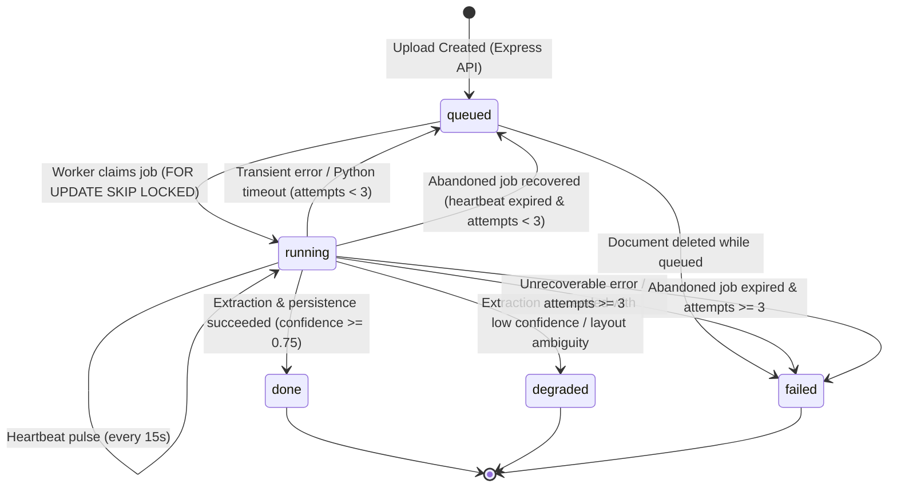

# M1.6.4.1 — Worker Architecture and Integration Contract Audit

## 1. Executive Summary & Existing Architecture Findings

### 1.1 Architectural Context
Retrieva AI is undergoing a phased architectural migration (AIML-59) from a monolithic Python FastAPI backend to a decoupled multi-service architecture:
- **React Frontend**: User interfaces for document ingestion, multi-modal layout inspection, semantic spatial search, and evaluation KPI dashboards.
- **Express API & Orchestrator (Node.js)**: Responsible for external HTTP client traffic, file upload validation, physical storage coordination, sequence-based document ID allocation, MySQL persistence, job queue management, and durable filesystem cleanup.
- **Python FastAPI Intelligence Service**: Responsible for document intelligence, including PDF layout extraction (PdfPlumber, Docling), reading-order recovery (LayoutOrderRecovery), multi-signal confidence calibration (Platt scaling), provenance tracking (SHA-256 cryptographic lineage), and FAISS dense vector retrieval.
- **MySQL 8.4**: Authoritative relational data store for documents, layout elements, ingestion jobs, sequence generators, cleanup queues, and evaluation benchmark runs.
- **FAISS**: File-based and in-memory vector index powering spatial and semantic similarity search over extracted document chunks.

### 1.2 State of Completed Milestones
1. **M1.6.1 (Express API Foundation)**: Introduced Express on port 3001 with standardized API envelopes, CORS, request tracking, and health/readiness endpoints without disrupting FastAPI (port 8000).
2. **M1.6.2 (Express Read APIs)**: Implemented high-performance, read-only document and element routes in Express using MySQL repositories.
3. **M1.6.3–M1.6.3.2 (Upload Lifecycle & Concurrency Hardening)**: Moved document uploads, batch uploads, atomic document ID generation (`document_sequences`), durable file deletion (`cleanup_queue`), and deadlock-free locking protocols into Express.
4. **Current Ingestion State**: When a user uploads a document through Express, Express validates the PDF, allocates a canonical `doc-NNN` ID, writes the file to `data/uploads/`, creates the document record (`status = 'queued'`), and enqueues an ingestion job (`status = 'queued'`) in MySQL.

### 1.3 Key Architectural Finding
The ingestion job currently remains in `status = 'queued'` because the background worker has not yet been implemented. Furthermore, the existing Python FastAPI application currently only exposes ingestion through its public multipart upload endpoints (`POST /api/v1/documents/upload` and `/upload-batch`), which re-read uploaded file streams, assign uncoordinated internal document IDs, and maintain in-memory state. 

M1.6.4 introduces the standalone Node.js Worker process that dequeues jobs from MySQL, invokes an explicit internal extraction contract on the Python service passing the on-disk file path and pre-allocated document ID, persists the resulting layout elements into MySQL, and synchronizes FAISS vector indexing.

---

## 2. Existing Python Service Audit

### 2.1 Available HTTP Endpoints
Inspection of `backend/app/main.py` and `backend/app/api/v1/` reveals the following registered routes:

| HTTP Method | Route | Subsystem | Request Payload | Response Model |
|---|---|---|---|---|
| `GET` | `/` | Discovery | None | `BaseResponse[dict]` |
| `GET` | `/api/v1/health` | Diagnostic | None | `BaseResponse[HealthData]` |
| `POST` | `/api/v1/health/reload` | Admin | None | `BaseResponse[dict]` |
| `GET` | `/api/v1/ready` | Diagnostic | None | `BaseResponse[dict]` |
| `GET` | `/api/v1/documents` | Retrieval | None | `BaseResponse[List[DocumentSummary]]` |
| `GET` | `/api/v1/documents/analytics/summary` | Analytics | None | `BaseResponse[Dict[str, Any]]` |
| `GET` | `/api/v1/documents/batch/{batch_id}` | Ingestion | Path param | `BaseResponse[BatchUploadResponse]` |
| `GET` | `/api/v1/documents/{document_id}` | Retrieval | Path param | `BaseResponse[DocumentSummary]` |
| `GET` | `/api/v1/documents/{document_id}/file` | Binary Stream | Path param | `FileResponse` (PDF binary) |
| `POST` | `/api/v1/documents/upload` | Ingestion | Multipart `file` | `BaseResponse[DocumentSummary]` |
| `POST` | `/api/v1/documents/upload-batch` | Ingestion | Multipart `files` | `BaseResponse[BatchUploadResponse]` |
| `DELETE` | `/api/v1/documents/{document_id}` | Lifecycle | Path param | `BaseResponse[Dict[str, Any]]` |
| `GET` | `/api/v1/documents/{document_id}/pages/{page_number}` | Layout | Path param | `BaseResponse[List[SegmentSchema]]` |
| `POST` | `/api/v1/search` | Search | `QueryRequest` (query, top_k, doc_ids) | `BaseResponse[List[SearchResultItem]]` |
| `POST` | `/api/v1/search/aggregate` | Search | `MultiDocumentSearchRequest` | `BaseResponse[MultiDocumentSearchResponse]` |
| `GET` | `/api/v1/evaluation/latest` | Acceptance | None | `BaseResponse[Dict[str, Any]]` |

### 2.2 Extraction & Ingestion Pipeline Flow
Inside `DocumentService.upload_document(file_bytes, filename)` (`backend/app/services/document_service.py`):
1. **Validation**: Enforces max size (`max_upload_size_mb`), `.pdf` extension, `%PDF-` binary magic header, and page count bounds via PyMuPDF (`fitz`).
2. **Deduplication**: Calculates SHA-256 over raw bytes; returns existing document summary if duplicate hash is matched in memory.
3. **ID Assignment**: Scans existing in-memory keys for `doc-NNN` and increments the maximum number.
4. **File Persistence**: Writes file bytes to `data/uploads/{doc_id}_{filename}`.
5. **Extraction**: Calls `self.extractor.extract(saved_path)` returning a list of `Element` objects.
6. **Layout Recovery**: Calls `self.layout_recovery.process(raw_elements)` assigning monotonic `reading_order` across columns and sidebars.
7. **Provenance & Calibration**: Calls `self.provenance_subsystem.process_elements(ordered_elements, saved_path)` attaching cryptographic hashes, spatial bounds, Platt-calibrated confidence, and degraded routing flags.
8. **Degraded Mode Checks**: Evaluates low confidence, scrambled reading order, or table flattening.
9. **Chunking & Indexing**: Calls `self.chunker.chunk_elements(...)` creating `Chunk` objects and adds them to `self.retriever.index(self.all_chunks)`.
10. **Storage**: Stores `SegmentSchema` objects in `self.page_segments[new_doc_id]` and metadata in `self.documents[new_doc_id]`.

### 2.3 Limitations & Integration Gap
- **No Path-Based Processing**: The Python service currently requires multipart file upload over HTTP to trigger extraction. It has no endpoint to process an existing file already stored on disk.
- **Uncoordinated ID Assignment**: Python generates `doc-NNN` from an in-memory dictionary. Calling `POST /upload` from the worker would conflict with Express's atomic database sequence (`document_sequences`).
- **In-Memory Retention**: Extracted elements are retained in Python process memory rather than returned as a complete payload to the caller for MySQL storage.
- **Safe Contract Requirement**: To integrate cleanly, Python must expose an internal endpoint that accepts `{ document_id, file_path, mode }`, processes the existing on-disk PDF without re-saving, updates its local FAISS index, and returns all structured elements and metrics to the Express worker.

---

## 3. Existing MySQL Job Lifecycle Audit

### 3.1 Schema & Table Definitions (Migrations 001–004)
The schema in `backend/src/db/migrations/` establishes the relational foundations:

#### `documents` Table
- `id`: BIGINT AUTO_INCREMENT PRIMARY KEY
- `document_id`: VARCHAR(64) UNIQUE (public stable identifier, e.g. `doc-001`)
- `filename`: VARCHAR(255) NOT NULL
- `sha256`: CHAR(64) NOT NULL UNIQUE
- `path`: VARCHAR(1024) NOT NULL
- `pages_count`: INT NOT NULL
- `doc_type`: VARCHAR(50) NOT NULL DEFAULT 'user_upload'
- `split`: VARCHAR(20) NOT NULL DEFAULT 'none'
- `status`: VARCHAR(30) NOT NULL DEFAULT 'queued'
- `metadata`: JSON NULL
- `created_at`: TIMESTAMP NOT NULL DEFAULT CURRENT_TIMESTAMP
- `updated_at`: TIMESTAMP NOT NULL DEFAULT CURRENT_TIMESTAMP ON UPDATE CURRENT_TIMESTAMP
- `deleted_at`: TIMESTAMP(6) NULL

#### `jobs` Table
- `id`: BIGINT AUTO_INCREMENT PRIMARY KEY
- `doc_id`: BIGINT NOT NULL (foreign key referencing `documents(id)` ON DELETE CASCADE)
- `mode`: VARCHAR(30) NOT NULL (e.g. `'flat'`, `'reference'`, `'candidate'`, `'candidate_ft'`)
- `status`: ENUM('queued', 'running', 'done', 'degraded', 'failed') NOT NULL DEFAULT 'queued'
- `seconds`: FLOAT NULL
- `error`: TEXT NULL
- `attempts`: INT NOT NULL DEFAULT 0
- `created_at`: TIMESTAMP NOT NULL DEFAULT CURRENT_TIMESTAMP
- `updated_at`: TIMESTAMP NOT NULL DEFAULT CURRENT_TIMESTAMP ON UPDATE CURRENT_TIMESTAMP
- Indexes: `idx_jobs_status (status)`, `idx_jobs_doc_status (doc_id, status)`

#### `elements` Table
- `id`: BIGINT AUTO_INCREMENT PRIMARY KEY
- `doc_id`: BIGINT NOT NULL (foreign key referencing `documents(id)` ON DELETE CASCADE)
- `mode`: ENUM('flat', 'reference', 'candidate', 'candidate_ft') NOT NULL
- `type`: ENUM('text', 'heading', 'table', 'formula', 'figure', 'caption') NOT NULL
- `page`: INT NOT NULL (CHECK `page >= 1`)
- `reading_order`: INT NOT NULL (CHECK `reading_order >= 0`)
- `text`: MEDIUMTEXT NULL
- `bbox`: JSON NULL
- `structured`: JSON NULL
- `confidence`: FLOAT NOT NULL DEFAULT 1.0 (CHECK `confidence >= 0.0 AND confidence <= 1.0`)
- `provenance`: JSON NULL
- `flags`: JSON NULL
- `model_version`: VARCHAR(64) NULL
- `created_at`: TIMESTAMP NOT NULL DEFAULT CURRENT_TIMESTAMP
- Indexes: `idx_elements_doc_mode_reading_order (doc_id, mode, reading_order)`, `idx_elements_doc_page (doc_id, page)`, `idx_elements_doc_type (doc_id, type)`

### 3.2 Current Repository Methods & Deficiencies

| Repository | Existing Methods | Missing Capabilities for Worker |
|---|---|---|
| `jobRepository` | `createJob`, `findById`, `cancelQueuedJobsForDocument`, `findByDocument`, `listPending`, `claimJob` (`FOR UPDATE SKIP LOCKED`), `updateStatus`, `incrementAttempts`, `retryJob` | Lacks persistent worker identity (`locked_by`), lease timestamp (`locked_at`), heartbeat tracking (`heartbeat_at`), and lease-expiration recovery query. |
| `documentRepository` | `createDocument`, `findById`, `findByDocumentId`, `findBySha256`, `listDocuments`, `updateStatus`, `softDelete`, `restore` | `updateStatus` only takes status string. Cannot update document `metadata` (JSON with metrics, chunk count, parsing accuracy, degraded flags) or `pages_count`. |
| `elementRepository` | `bulkInsert`, `findByDocument`, `findByPage`, `deleteByDocAndMode` | Fully capable. Supports atomic transactional insertion with preflight check-constraint validation and duplicate prevention via `deleteByDocAndMode`. |
| `cleanupQueue` | `enqueueCleanup`, `safeUnlinkFile`, `processPendingCleanups`, `retryFailedCleanups` | Fully capable. Handles durable file unlink retries up to 5 attempts. Can be directly invoked by the worker lifecycle. |

---

## 4. Proposed Worker Architecture

### 4.1 Architecture Overview
The worker is implemented as a standalone Node.js process: `backend/src/worker.js`.
- It executes independently from the Express HTTP server process (`backend/src/server.js`).
- Long-running PDF extraction and layout analysis will never block Express's event loop or delay incoming client requests.
- Communicates directly with MySQL via `backend/src/db/pool.js` and with Python FastAPI via HTTP (`fetch` or Axios).
- No message brokers (RabbitMQ, Kafka) or distributed caches (Redis) are introduced. Concurrency control and queue state rely entirely on MySQL InnoDB row-level locking.

```
+-----------------------------------------------------------------------------------+
|                                 REACT FRONTEND                                    |
+----------------------------------------+------------------------------------------+
                                         | HTTP (Port 3001)
                                         v
+-----------------------------------------------------------------------------------+
|                        EXPRESS HTTP API (backend/src/server.js)                    |
|  - Validates upload binary and stores PDF to disk (data/uploads/doc-NNN_name.pdf) |
|  - Allocates doc-NNN via document_sequences                                       |
|  - Creates documents (status='queued') & jobs (status='queued') in MySQL          |
+----------------------------------------+------------------------------------------+
                                         |
                                         v (Shared Database)
+-----------------------------------------------------------------------------------+
|                                  MYSQL 8.4 DATABASE                                |
|  - documents (metadata, lifecycle state)                                          |
|  - jobs (queue state, attempts, worker leases, heartbeats)                        |
|  - elements (extracted bounding boxes, reading order, tables, formulas)           |
|  - cleanup_queue (durable retryable file deletions)                               |
+----------------------------------------+------------------------------------------+
                                         ^
                                         | (FOR UPDATE SKIP LOCKED)
+----------------------------------------+------------------------------------------+
|                       STANDALONE WORKER (backend/src/worker.js)                   |
|  - Claims queued job atomically with persistent worker identity                   |
|  - Emits periodic background heartbeats                                           |
|  - Dispatches extraction request to Python via HTTP POST /internal/extract        |
|  - Persists layout elements via elementRepository.bulkInsert                      |
|  - Updates job (done/degraded) and document (processed)                           |
|  - Executes retryFailedCleanups() on idle ticks                                   |
+----------------------------------------+------------------------------------------+
                                         | HTTP POST /api/v1/internal/extract
                                         v
+-----------------------------------------------------------------------------------+
|                        PYTHON FASTAPI INTELLIGENCE SERVICE                        |
|  - Reads file from local path without re-upload                                   |
|  - Executes PdfPlumber / Docling extraction                                       |
|  - Executes LayoutOrderRecovery & ProvenanceSubsystem (Platt calibration)         |
|  - Generates chunks and updates in-memory/file FAISS index                        |
|  - Returns extracted elements and document metrics to Worker                      |
+-----------------------------------------------------------------------------------+
```

### 4.2 Worker Processing Loop
The worker operates an asynchronous loop with configurable intervals:
1. **Poll Queue**:
   Calls `jobRepository.claimJob(workerId)`.
   Inside `claimJob`:
   - Begins transaction.
   - Executes `SELECT * FROM jobs WHERE status = 'queued' ORDER BY id ASC LIMIT 1 FOR UPDATE SKIP LOCKED`.
   - Executes `SELECT id, document_id, deleted_at, path FROM documents WHERE id = ? FOR SHARE`.
   - If document is soft-deleted, marks job `failed` (`'Document deleted before processing'`) and commits.
   - Sets `status = 'running'`, `locked_by = workerId`, `locked_at = NOW()`, `heartbeat_at = NOW()`, `attempts = attempts + 1`.
   - Commits transaction.
2. **If Job Claimed**:
   - Updates document status: `documentRepository.updateStatus(job.doc_id, 'processing')`.
   - Starts periodic heartbeat timer (every 15s) executing `jobRepository.updateHeartbeat(job.id, workerId)`.
   - Sends HTTP POST request to Python service: `POST /api/v1/internal/extract` with `{ document_id, file_path, mode }`.
   - Uses `AbortController` with configurable timeout (e.g. `PYTHON_TIMEOUT_MS = 60000`).
3. **On Successful Extraction**:
   - Stops heartbeat timer.
   - Cleans previous partial extractions for this document arm: `elementRepository.deleteByDocAndMode(job.doc_id, job.mode)`.
   - Atomically persists extracted elements: `elementRepository.bulkInsert(elements, { docId: job.doc_id })`.
   - Updates document record via new `documentRepository.updateProcessingResults`:
     - `status = 'processed'` (or `'processed (degraded)'` if degraded flag is active).
     - `pages_count = result.pages_count`.
     - `metadata = { ...existing, metrics: result.metrics, chunk_count: result.chunk_count, parsing_accuracy: result.parsing_accuracy, is_degraded: result.is_degraded }`.
   - Updates job record: `jobRepository.updateStatus(job.id, result.is_degraded ? 'degraded' : 'done', { seconds })`.
   - Clears lease fields: `locked_by = NULL`, `locked_at = NULL`, `heartbeat_at = NULL`.
   - Triggers `cleanupQueue.retryFailedCleanups(10)` to perform background filesystem hygiene.
   - Dispatches immediate next poll tick via `setImmediate()`.
4. **On Error or Timeout**:
   - Stops heartbeat timer.
   - Evaluates retry policy:
     - If `job.attempts < maxAttempts` (default 3): marks job `queued` for retry, records error message, leaves document in `queued` status.
     - If `job.attempts >= maxAttempts`: marks job `failed` (`error = errorMessage`), updates document status to `failed`.
   - Clears lease fields.
   - Dispatches immediate next poll tick.
5. **If No Job Claimed (Queue Empty)**:
   - Executes `jobRepository.recoverAbandonedJobs(leaseTimeoutSeconds)` to reclaim jobs from dead workers.
   - Executes `cleanupQueue.retryFailedCleanups(10)` (rate-limited to at most once per 60s).
   - Sleeps for `POLL_INTERVAL_MS` (default 2000ms) before the next iteration.

### 4.3 Graceful Shutdown Protocol
When `SIGINT` or `SIGTERM` is received:
1. Worker sets `isShuttingDown = true`.
2. Stops accepting new jobs from the queue.
3. If an active job is processing:
   - Allows up to `SHUTDOWN_TIMEOUT_MS` (default 30s) for the current extraction and persistence to complete.
   - If the timeout expires before completion, aborts the Python HTTP request via `AbortController` and releases the job back to `status = 'queued'` with `locked_by = NULL` so another worker can pick it up.
4. Cleans up heartbeat intervals and polling timers.
5. Closes the MySQL pool cleanly via `pool.closePool()`.
6. Exits with status code 0.

---

## 5. Job State-Transition Diagram



### State Matrix & Transition Invariants

| From State | To State | Trigger | Action / Side Effects |
|---|---|---|---|
| `queued` | `running` | `jobRepository.claimJob(workerId)` | Lock `jobs` row, lock `documents` row (FOR SHARE), verify not deleted, set `locked_by = workerId`, `heartbeat_at = NOW()`, increment `attempts`. Document set to `processing`. |
| `queued` | `failed` | `DELETE /api/v1/documents/:id` | Document soft-deleted before processing. Job canceled with error `'Document deleted before processing'`. |
| `running` | `running` | Periodic Heartbeat | Worker updates `heartbeat_at = NOW()`. Prevents lease expiration. |
| `running` | `done` | Extraction Success | Python returned valid elements. Elements persisted to MySQL. FAISS index updated. Document status set to `processed`. `seconds` recorded. Leases cleared. |
| `running` | `degraded` | Degraded Success | Confidence below threshold (0.75) or table headers unparsed. Elements and chunks persisted. Document status set to `processed (degraded)`. `seconds` recorded. Leases cleared. |
| `running` | `queued` | Transient Error / Timeout | Python 500, network reset, or timeout with `attempts < 3`. Error recorded, lease cleared, status returned to `queued` for backoff retry. |
| `running` | `queued` | Abandoned Recovery | Worker crashed without updating heartbeat (`NOW() - heartbeat_at > lease_timeout`) and `attempts < 3`. Reclaimed by supervisor/worker. |
| `running` | `failed` | Terminal Failure | Invalid PDF structure, missing file, or `attempts >= 3`. Error recorded. Document status set to `failed`. |
| `running` | `failed` | Abandoned Terminal | Worker crashed and `attempts >= 3`. Marked `failed` with error `'Abandoned job exceeded max retry attempts'`. Document set to `failed`. |

---

## 6. Python-to-MySQL Data Mapping

### 6.1 Field-by-Field Mapping Specification

| Field Conceptual Purpose | Python Object (`EnrichedElement`) | Express Worker Transform | MySQL `elements` Table Column | FAISS Index Property |
|---|---|---|---|---|
| Document Reference | `document_id: str` | `resolveNumericDocId(doc_id)` | `doc_id: BIGINT NOT NULL` | `source_doc_id: str` |
| Execution Mode Arm | `mode: str` | Validated against `VALID_MODES` | `mode: ENUM('flat','reference','candidate','candidate_ft')` | Mode metadata tag |
| Semantic Element Type | `element.type: ElementType` | `type.value.lower()` | `type: ENUM('text','heading','table','formula','figure','caption')` | Chunk type filtering |
| Document Page Number | `element.page: int` | Integer $\ge 1$ | `page: INT NOT NULL` | `page_numbers: List[int]` |
| Reading Order Sequence | `element.reading_order: int` | Integer $\ge 0$ | `reading_order: INT NOT NULL` | Sequence ordering in text |
| Textual Content | `element.text: str` | Plaintext string | `text: MEDIUMTEXT NULL` | Vectorized text embedding |
| Spatial Bounding Box | `element.bbox: BoundingBox` | `JSON.stringify({ x_min, y_min, x_max, y_max, width, height })` | `bbox: JSON NULL` | `bbox_union: BoundingBox` |
| Structured Table / Formula | `element.table_cells` or `element.formula_data` | Normalized table grid `{ num_rows, num_cols, headers, rows }` or formula `{ latex, text, formula_type }` | `structured: JSON NULL` | Serialized Markdown table / LaTeX text in chunk |
| Calibrated Confidence | `confidence_signals.calibrated_confidence` | Float clamped to $[0.0, 1.0]$ | `confidence: FLOAT NOT NULL` | Weighting multiplier for retrieval ranking |
| Lineage & Provenance | `provenance: ProvenanceRecord` | `JSON.stringify({ element_id, source_file_hash, extractor_name, extractor_version, config_id, timestamp })` | `provenance: JSON NULL` | Provenance hash reference |
| Quality & Degraded Flags | `routing: DegradedRoutingRecord` | `JSON.stringify({ is_degraded, routing_action, reasons, fallback_strategy })` | `flags: JSON NULL` | `is_degraded: bool` |
| Extraction Backend Version | `provenance.extractor_version` | String (e.g. `'pdfplumber-0.11.4'`) | `model_version: VARCHAR(64) NULL` | Model version stamp |

### 6.2 Mode Preservation
The system must preserve the 4 experimental evaluation modes without schema modification:
1. `'flat'`: Baseline unstructured standard text extraction.
2. `'reference'`: Authoritative human-verified or frozen benchmark ground truth extraction.
3. `'candidate'`: Standard multi-modal layout extraction (PdfPlumber + LayoutOrderRecovery).
4. `'candidate_ft'`: Fine-tuned or enhanced multi-modal layout extraction (Docling + LayoutOrderRecovery).

---

## 7. Crash Recovery and Retry Design

### 7.1 Worker Identity & Lease Protocol
- **Worker Identity**: Format: `worker_{hostname}_{pid}_{randomHex4}` (e.g. `worker_srv1_4192_8f2a`).
- **Heartbeat Emission**: While a job is running, the worker runs an interval timer every `HEARTBEAT_INTERVAL_MS = 15000` executing:
  ```sql
  UPDATE jobs 
  SET heartbeat_at = CURRENT_TIMESTAMP 
  WHERE id = ? AND locked_by = ? AND status = 'running'
  ```
- **Lease Expiration Threshold**: Default `lease_timeout_seconds = 300` (5 minutes). If a worker process abruptly dies, is SIGKILLed, or suffers node failure, its heartbeat stops.

### 7.2 Abandoned Job Recovery Algorithm
On every idle tick or at startup, the worker executes an abandoned job sweep:
```sql
SELECT id, doc_id, attempts 
FROM jobs 
WHERE status = 'running' 
  AND heartbeat_at < (NOW() - INTERVAL lease_timeout_seconds SECOND)
ORDER BY id ASC
LIMIT 5
FOR UPDATE SKIP LOCKED
```
For each matched abandoned job:
- If `attempts < maxAttempts`:
  Transitions `status = 'queued'`, `locked_by = NULL`, `locked_at = NULL`, `heartbeat_at = NULL`, and sets `error = 'Reclaimed after worker heartbeat timeout'`.
- If `attempts >= maxAttempts`:
  Transitions `status = 'failed'`, `error = 'Job abandoned and exceeded max retry attempts'`. Updates document status to `'failed'`.

### 7.3 Persistence Idempotency Guarantee
If a worker crashes after Python completes extraction and vector indexing, but before MySQL elements are saved:
1. When the job is reclaimed and retried, the worker calls:
   ```javascript
   await elementRepository.deleteByDocAndMode(job.doc_id, job.mode, { connection: conn });
   ```
   inside the same transaction as `elementRepository.bulkInsert`.
2. This eliminates duplicate element rows and prevents constraint violations upon retry.
3. On the Python service side, calling `chunker.chunk_elements` and `retriever.index` replaces or updates chunks for that `doc_id`, ensuring FAISS index idempotency.

### 7.4 Python Service Resilience & Timeouts
- **Health Preflight**: Worker verifies Python service health via `GET /api/v1/health` prior to processing if a previous connection failed.
- **Request Timeout**: Configured via `PYTHON_REQUEST_TIMEOUT_MS = 60000` (60s). Handled using Node.js `AbortController`. If timed out, aborted cleanly without leaving dangling sockets.
- **Exponential Backoff**: If Python is offline (`ECONNREFUSED`, 502, 503), the worker backs off exponentially: $2\text{s} \rightarrow 4\text{s} \rightarrow 8\text{s} \rightarrow 16\text{s} \rightarrow \text{max } 30\text{s}$ to avoid log flooding and CPU thrashing.

### 7.5 Filesystem Cleanup Queue Integration
During idle queue ticks and at the conclusion of every processed job, the worker calls:
```javascript
await cleanupQueue.retryFailedCleanups(10);
```
This safely retries deferred file unlinks from failed uploads or deleted documents (handling Windows EBUSY file locks) without impacting the Express HTTP server thread.

---

## 8. Required Schema Changes & Proposed Forward-Only Migration

### 8.1 Immutability Policy
Existing migrations `001_init.sql`, `002_schema_compatibility.sql`, `003_document_sequences.sql`, and `004_durable_cleanup_queue.sql` are frozen and immutable. All schema adjustments must be introduced through a new forward-only migration: `005_worker_leases.sql`.

### 8.2 Migration Specification: `005_worker_leases.sql`
```sql
-- =============================================================================
-- Retrieva AI — Migration 005: Worker Leases and Heartbeat Tracking
-- Adds persistent worker lease ownership, lock timestamps, and heartbeat tracking
-- to the jobs table for crash recovery and distributed worker safety.
-- =============================================================================

ALTER TABLE jobs
    ADD COLUMN locked_by VARCHAR(64) NULL AFTER attempts,
    ADD COLUMN locked_at TIMESTAMP NULL AFTER locked_by,
    ADD COLUMN heartbeat_at TIMESTAMP NULL AFTER locked_at,
    ADD COLUMN lease_timeout_seconds INT NOT NULL DEFAULT 300 AFTER heartbeat_at;

ALTER TABLE jobs
    ADD INDEX idx_jobs_status_heartbeat (status, heartbeat_at);
```

### 8.3 Schema Verification Checks for `migrator.js`
In `backend/src/db/migrator.js`:
- Check for presence of columns `locked_by`, `locked_at`, `heartbeat_at`, and `lease_timeout_seconds` in `INFORMATION_SCHEMA.COLUMNS` for table `jobs`.
- Check for presence of index `idx_jobs_status_heartbeat` in `INFORMATION_SCHEMA.STATISTICS`.

---

## 9. File-by-File Implementation Plan for M1.6.4

### Phase 1: Python Internal Extraction Endpoint (FastAPI)
1. **`backend/app/schemas/internal.py` (New File)**
   - `InternalExtractRequest`: `{ document_id: str, file_path: str, mode: str }`
   - `InternalExtractResponse`: `{ document_id: str, pages_count: int, is_degraded: bool, metrics: DocumentMetrics, parsing_accuracy: float, elements: List[SegmentSchema], chunk_count: int }`
2. **`backend/app/services/document_service.py` (Modify Existing)**
   - Add method `process_document_by_path(document_id: str, file_path: Path, mode: str)`:
     - Extracts from `file_path` without copying or re-saving.
     - Runs layout order recovery and provenance calibration.
     - Generates chunks and updates the FAISS vector retriever.
     - Returns elements and summary metrics matching `InternalExtractResponse`.
3. **`backend/app/api/v1/internal.py` (New File) & `backend/app/api/v1/router.py` (Modify Existing)**
   - Expose `POST /api/v1/internal/extract` guarded with loopback/internal checks.
   - Register route in `api_v1_router`.

### Phase 2: Database Schema & Migration (MySQL)
4. **`backend/src/db/migrations/005_worker_leases.sql` (New File)**
   - Add `locked_by`, `locked_at`, `heartbeat_at`, `lease_timeout_seconds`, and index `idx_jobs_status_heartbeat`.
5. **`backend/src/db/migrator.js` (Modify Existing)**
   - Add version 005 detection to `detectPartialSchema()` and `verifySchema()`.
6. **`backend/src/db/tests/test_migration.js` (Modify Existing)**
   - Add test coverage for migration 005 immutability and checksum validation.

### Phase 3: Repository Layer Enhancements (Express / MySQL)
7. **`backend/src/db/repositories/jobRepository.js` (Modify Existing)**
   - Update `claimJob(workerId)` to record `locked_by = workerId`, `locked_at = NOW()`, `heartbeat_at = NOW()`.
   - Add `updateHeartbeat(jobId, workerId)`.
   - Add `recoverAbandonedJobs(leaseTimeoutSeconds)`.
   - Update `updateStatus` and `retryJob` to clear lease fields upon completion or retry.
8. **`backend/src/db/repositories/documentRepository.js` (Modify Existing)**
   - Add `updateProcessingResults(idOrDocId, { status, pagesCount, metadata })` to persist extraction metrics, chunk count, and degraded status after worker extraction.

### Phase 4: Standalone Worker Engine (Node.js)
9. **`backend/src/config/index.js` (Modify Existing)**
   - Add worker configuration parameters:
     - `workerPollIntervalMs` (default `2000`)
     - `workerHeartbeatIntervalMs` (default `15000`)
     - `workerLeaseTimeoutSec` (default `300`)
     - `pythonServiceUrl` (default `http://127.0.0.1:8000`)
     - `pythonRequestTimeoutMs` (default `60000`)
10. **`backend/src/worker.js` (New File)**
    - Implement the standalone worker process: polling loop, heartbeat timer, Python extraction dispatch, repository transactions, crash recovery, and graceful shutdown handlers.
11. **`backend/package.json` (Modify Existing)**
    - Add script: `"worker": "node src/worker.js"`.

### Phase 5: Verification & Integration Test Suite
12. **`backend/src/tests/test_worker_lifecycle.js` (New File)**
    - Test job claiming and processing end-to-end.
    - Test heartbeat pulse and lease renewal.
    - Test recovery of abandoned jobs after simulated worker crash.
    - Test retry behavior on Python timeout or 500 error.
    - Test persistence of elements across all 4 modes.
    - Test graceful shutdown on SIGTERM.

---

## 10. Risks, Failure Modes, and Acceptance Tests

### 10.1 Identified Risks & Mitigations

| Risk | Impact | Mitigation Strategy |
|---|---|---|
| Python extraction crash on corrupt PDF | Worker could hang or abort abruptly | Use `try/except` in Python returning structured 500 error; Worker wraps HTTP dispatch in timeout (`AbortController`) and records failure. |
| Worker process crashes midway through element insertion | Partial elements written to MySQL | Wrap `deleteByDocAndMode` and `bulkInsert` in a single database transaction (`conn.beginTransaction()`). Rollback on failure. |
| Dual workers claim the same job | Duplicate processing and FAISS index bloat | Enforce `SELECT ... FOR UPDATE SKIP LOCKED` inside InnoDB transaction. Single job can only be locked by one connection. |
| Stale lease locks job indefinitely after worker SIGKILL | Queued document never finishes | Periodic `recoverAbandonedJobs` query checks `heartbeat_at < NOW() - lease_timeout` and returns job to `queued`. |
| Out of memory during large PDF extraction | System OOM killer terminates Python or Worker | Limit worker concurrency to $N=1$. PyMuPDF streams pages sequentially. Enforce memory ceiling via `--max-old-space-size=2048`. |
| Deletion occurs while worker is extracting | Inconsistent database or disk state | Worker holds `jobs` lock; Express deletion checks `SELECT * FROM jobs FOR UPDATE` and returns HTTP 409 Conflict if job is `running`. |

### 10.2 Acceptance Test Matrix (M1.6.4)

| Test ID | Scenario | Expected Outcome |
|---|---|---|
| **AC-1** | Single Document Ingestion | Document uploaded to Express is claimed by worker, processed by Python, elements written to MySQL, FAISS index updated, document status becomes `processed`, job status becomes `done`. |
| **AC-2** | Degraded Document Ingestion | Document with low OCR confidence completes with status `processed (degraded)` and job status `degraded`; elements stored with flags. |
| **AC-3** | Transient Python Failure Retry | Simulated Python 503 causes job to retry up to 3 times before terminal failure. |
| **AC-4** | Terminal Failure Handling | Corrupt document reaching 3 failed attempts transitions job and document to `failed` with diagnostic error message. |
| **AC-5** | Abandoned Lease Recovery | Worker simulated crash leaves job in `running` without heartbeat; recovery routine safely returns job to `queued` after lease timeout. |
| **AC-6** | Multi-Arm Mode Isolation | Ingesting same document under `'flat'` and `'candidate'` stores elements with disjoint modes without cross-contamination. |
| **AC-7** | Graceful Shutdown | Worker receiving `SIGTERM` completes active job before closing database pool and exiting cleanly. |
| **AC-8** | Filesystem Cleanup Processing | Pending unlinks in `cleanup_queue` are purged by worker during idle ticks. |

---

## 11. Resource Planning Reference
- **System Memory**: Planning baseline of 20 GB host RAM.
  - Express Worker Process: ~150 MB baseline heap, capped at 2 GB (`--max-old-space-size=2048`).
  - Python FastAPI Service: ~800 MB baseline, peaks at ~2.5 GB during large PDF parsing and FAISS embedding.
  - MySQL 8.4 Daemon: ~600 MB buffer pool.
  - Total System Allocation: < 6 GB, leaving > 14 GB headroom for OS, caching, and background tasks.
- **Concurrency**: Bounded at $N=1$ active job per worker process for initial stability. Telemetry for CPU (`process.cpuUsage()`) and memory (`process.memoryUsage()`) will be logged per job for subsequent tuning.
